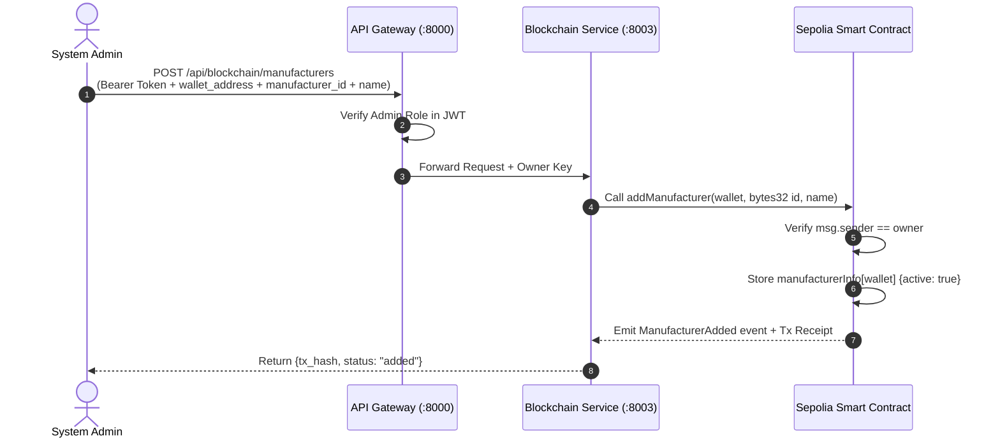
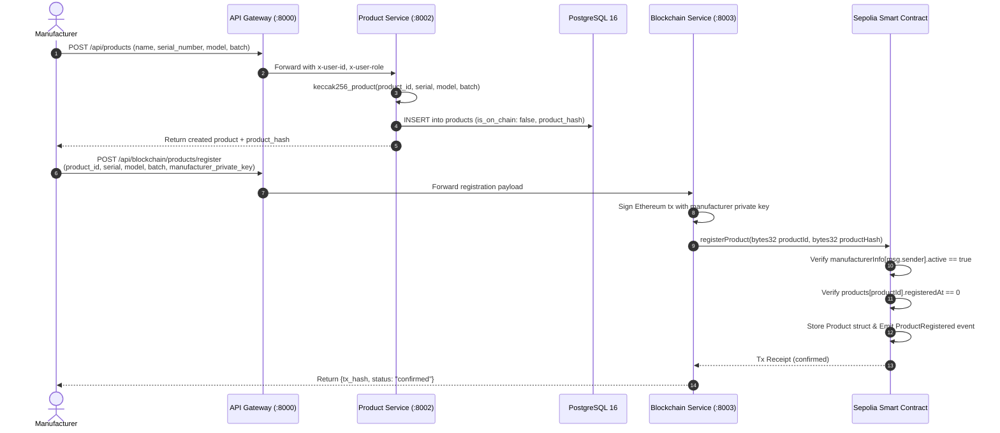
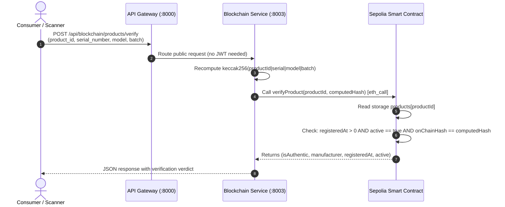

# Operational Knowledge File (OKF) — Product Verification System

> **Document Type:** Master Operational Knowledge File (Single Source of Truth)  
> **Target Audience:** AI Assistants, Software Engineers, Blockchain Architects, Auditors, DevOps  
> **Status:** Active & Production-Ready  
> **Project Root:** `d:/learning/sample-projects/product-verification`

---

## 1. Executive Mission & System Purpose

Counterfeiting of pharmaceuticals, luxury goods, electronics, and automotive parts causes hundreds of billions of dollars in losses annually and endangers consumer safety. Traditional anti-counterfeiting mechanisms fail because:
1. **Centralized databases are vulnerable:** Internal administrators or compromised database servers can tamper with serial records, or centralized servers can suffer downtime.
2. **Serial duplication (replay attacks):** Counterfeiters simply copy legitimate serial numbers onto thousands of fake products.
3. **Full on-chain storage is cost-prohibitive:** Writing complete product descriptions, images, and supply chain histories directly to Ethereum transactions consumes immense gas, making retail verification unviable.

### The Hybrid Solution
This platform implements an optimal **Hybrid On-Chain / Off-Chain Architecture**:
* **Off-Chain (FastAPI Microservices + PostgreSQL 16):** Stores rich, queryable business metadata (manufacturer details, model descriptions, batch numbers, serial numbers, SKU records, creation timestamps).
* **On-Chain (Ethereum EVM / Sepolia Smart Contract — `ProductRegistry.sol`):** Stores only an immutable **32-byte cryptographic fingerprint (`bytes32` `keccak256` hash)** alongside the registered manufacturer wallet address, registration timestamp, and lifecycle state (`active`).

$$\text{Off-Chain Metadata} \xrightarrow{\text{Canonical Packing}} \text{keccak256 Hash (32 bytes)} \xrightarrow{\text{Recorded on Ethereum}} \text{Immutable Proof}$$

**The Core Invariant:**  
If an attacker alters even a single character in the off-chain PostgreSQL database (e.g., swapping a serial number or modifying a batch), the recomputed hash mathematically diverges from the on-chain hash. The verification immediately flags the item as **Tampered / Counterfeit**.

---

## 2. Actors & Role-Based Access Control (RBAC)

The system enforces strict multi-tier permissions across the API Gateway, Auth Service, and Solidity Smart Contract:

| Actor | Identification & Auth | Contract Permissions | Off-Chain (API) Permissions |
|---|---|---|---|
| **System Admin** | JWT (`role: admin`) + Contract Owner Private Key | • `addManufacturer(wallet, id, name)`<br>• `removeManufacturer(wallet)`<br>• `deactivateProduct(productId)` | • Manage all user profiles<br>• Access Grafana observability dashboards<br>• View all telemetry metrics |
| **Authorized Manufacturer** | JWT (`role: manufacturer`) + Authorized Wallet Private Key | • `registerProduct(productId, hash)`<br>• `deactivateProduct(productId)` (own products) | • Create product catalog entries<br>• Trigger on-chain registration transactions<br>• Generate QR codes |
| **Retailer / Inspector** | JWT (`role: customer` or `manufacturer`) | • Read-only view calls | • Batch queries on product metadata<br>• Inspection audit logging |
| **Consumer / End-User** | No account required (Public / Anonymous) | • `verifyProduct(productId, hash)` (Gasless `view`)<br>• `getProduct(productId)` (Gasless `view`) | • Scan QR code / enter serial<br>• Query `/api/blockchain/products/verify`<br>• View authenticity verdicts |

---

## 3. Canonical Hashing & Cryptographic Specification

To guarantee reproducibility across diverse programming languages and EVM bytecode, the platform establishes a strict canonical hashing specification.

### Canonical Representation
The off-chain hashing utility (`services/common/crypto/hashing.py`) and smart contract expect four fundamental attributes in exact order:
1. `productId` (e.g., `"P10001"`)
2. `serialNumber` (e.g., `"SN001928"`)
3. `model` (e.g., `"ABC-X1"`)
4. `batch` (e.g., `"B2026-09"`)

### Canonical String (Human & QR representation)
```text
productId|serialNumber|model|batch
Example: "P10001|SN001928|ABC-X1|B2026-09"
```

### Deterministic Keccak256 Computation
In Python (`services/common/crypto/hashing.py`):
```python
from eth_abi.packed import encode_packed
from eth_utils import keccak

def keccak256_product(product_id: str, serial: str, model: str, batch: str) -> bytes:
    # Matches Solidity: keccak256(abi.encodePacked(productId, serial, model, batch))
    packed = encode_packed(
        ["string", "string", "string", "string"],
        [product_id, serial, model, batch],
    )
    return keccak(packed)
```

In Solidity (`ProductRegistry.sol`):
```solidity
keccak256(abi.encodePacked(productId, serial, model, batch))
```

### Key Identifier Encoding
* `productId` is cast to `bytes32` using right-padding with null bytes (`\x00`).
* Maximum length of `productId` string: 32 bytes (enforced by `keccak256_id()`).

---

## 4. System Architecture & Port Map

The system runs as an orchestrated containerized mesh via Docker Compose.

```
                     ┌─────────────────────────────────────────┐
                     │         Frontend SPA (Port 80)          │
                     │       Vanilla HTML5 / CSS3 / ES6        │
                     └────────────────────┬────────────────────┘
                                          │ HTTP :8000
                                          ▼
                     ┌─────────────────────────────────────────┐
                     │        API Gateway (Port 8000)          │
                     │  - Reverse Proxy (FastAPI)              │
                     │  - JWT Bearer Validation                │
                     │  - Header Injection (x-user-id/role)    │
                     └───────┬────────────┼────────────┬───────┘
                             │            │            │
             ┌───────────────┘            │            └───────────────┐
             ▼                            ▼                            ▼
   Auth Service (:8001)        Product Service (:8002)     Blockchain Service (:8003)
   - Identity & RBAC           - Relational Catalog        - web3.py EVM RPC
   - Bcrypt + HS256 JWT        - PostgreSQL CRUD           - Tx Signing (Sepolia)
   - PostgreSQL persistence    - Canonical Hash Generator  - Free `view` verification
             │                            │                            │
             └───────────────┬────────────┘                            ▼
                             ▼                               ┌───────────────────┐
                     PostgreSQL (:5432)                      │  Sepolia Testnet  │
                     - users table                           │  ProductRegistry  │
                     - products table                        │  Smart Contract   │
                             │                               └───────────────────┘
            All microservices stream structured JSON logs
                             │
                             ▼
                     Loki (:3100) ──▶ Grafana Dashboards (:3000)
                     (Local fallback: /app/logs/*.log)
```

### Port Allocation Reference

| Container / Service | Host Port | Internal Port | Protocol | Purpose |
|---|---|---|---|---|
| `frontend` | `80` | `80` | HTTP | Dark glassmorphism dashboard UI |
| `api-gateway` | `8000` | `8000` | HTTP | Gateway proxy, authentication gatekeeper |
| `auth-service` | `8001` | `8001` | HTTP | User registration, login, token issue |
| `product-service` | `8002` | `8002` | HTTP | Catalog CRUD, keccak256 hashing |
| `blockchain-service` | `8003` | `8003` | HTTP | EVM transaction signing, Sepolia RPC calls |
| `postgres` | `5432` | `5432` | TCP | Relational metadata database |
| `loki` | `3100` | `3100` | HTTP | Centralized structured log ingestion |
| `grafana` | `3000` | `3000` | HTTP | Telemetry and log visualization dashboard |

---

## 5. End-to-End Core Workflows

### Workflow 1: Manufacturer Onboarding (Admin Action)



---

### Workflow 2: Product Registration & Blockchain Minting



---

### Workflow 3: Public Consumer Verification (Zero Gas)



#### Verification Verdict Matrix

| Condition | `isAuthentic` | `active` | System Status | Consumer UI Display |
|---|---|---|---|---|
| Product exists on-chain, hash matches, `active == true` | `true` | `true` | **AUTHENTIC** | 🟢 Genuine Verified Product |
| Product exists on-chain, hash differs from input parameters | `false` | `true` | **TAMPERED** | 🔴 Counterfeit Alert (Hash Mismatch) |
| Product exists on-chain, but `active == false` | `false` | `false` | **RECALLED** | 🟡 Product Deactivated / Recalled |
| Product has `registeredAt == 0` | `false` | `false` | **NOT FOUND** | ⚪ Unregistered / Unknown Product |

---

### Workflow 4: Product Deactivation / Recall

1. **Trigger:** Manufacturer discovers a defective batch, stolen inventory, or countermanded serial numbers.
2. **Execution:** Authorized manufacturer (or contract owner) sends `POST /api/blockchain/products/deactivate` with `product_id` and their signer private key.
3. **Smart Contract Assertion:**
   ```solidity
   require(p.manufacturer == msg.sender || msg.sender == owner, "Not authorized");
   require(p.active, "Already deactivated");
   p.active = false;
   ```
4. **Audit Trail:** An irreversible `ProductDeactivated` event is emitted. Future verification calls return `active: false` and `isAuthentic: false`.

---

## 6. Smart Contract Deep Dive (`ProductRegistry.sol`)

* **Solidity Version:** `^0.8.20`
* **Target Network:** Ethereum Sepolia Testnet (EVM-compatible)
* **Optimization Rationale:** Zero dynamic storage strings inside the `Product` struct; stores only `bytes32` hash, reducing state gas cost from ~80,000 to ~20,000 gas per registration.

### Core Data Layout
```solidity
struct Manufacturer {
    bytes32 id;       // Unique manufacturer ID (e.g. keccak256("MFG001"))
    string  name;     // Company name (e.g. "Acme Corp")
    address wallet;   // Authorized signing wallet
    uint256 addedAt;  // UNIX timestamp
    bool    active;   // Active authorization status
}

struct Product {
    bytes32 productHash;   // keccak256(productId|serial|model|batch)
    address manufacturer;  // Registering wallet
    uint256 registeredAt;  // Block timestamp of creation
    bool    active;        // Active vs recalled
}
```

### State Storage & Modifiers
* `owner`: Deployer address possessing administrative governance.
* `manufacturerInfo[address]`: $O(1)$ lookup mapping for authorization checks.
* `products[bytes32 productId]`: $O(1)$ product lookup table.
* `onlyOwner`: Restricts administrative functions (`addManufacturer`, `removeManufacturer`).
* `onlyManufacturer`: Restricts `registerProduct` to active wallets in `manufacturerInfo`.

---

## 7. Relational Database Schema (PostgreSQL 16)

The relational database maintains application identities and product catalog records.

### Table: `users`
Managed by `auth-service` via SQLAlchemy (`services/auth-service/app/models/user.py`).

| Column | Type | Constraints | Description |
|---|---|---|---|
| `id` | `VARCHAR(36)` | PRIMARY KEY | UUIDv4 string |
| `email` | `VARCHAR(255)` | UNIQUE, NOT NULL, INDEX | Login email address |
| `hashed_password` | `VARCHAR(255)` | NOT NULL | Bcrypt salt + hash |
| `full_name` | `VARCHAR(255)` | NOT NULL | User's full name |
| `role` | `VARCHAR(50)` | NOT NULL | `'admin'`, `'manufacturer'`, or `'customer'` |
| `wallet_address` | `VARCHAR(42)` | NULLABLE | MetaMask wallet address (0x...) |
| `is_active` | `BOOLEAN` | DEFAULT `true` | Account active state |
| `created_at` | `TIMESTAMPTZ` | DEFAULT `NOW()` | Account creation time |

### Table: `products`
Managed by `product-service` via SQLAlchemy (`services/product-service/app/models/product.py`).

| Column | Type | Constraints | Description |
|---|---|---|---|
| `id` | `VARCHAR(36)` | PRIMARY KEY | Internal UUIDv4 string |
| `product_id` | `VARCHAR(64)` | UNIQUE, NOT NULL, INDEX | Human ID / On-chain key (e.g. `"P10001"`) |
| `name` | `VARCHAR(255)` | NOT NULL | Commercial product name |
| `serial_number` | `VARCHAR(128)` | NOT NULL | Physical serial number |
| `model` | `VARCHAR(128)` | NOT NULL | Model identifier |
| `batch` | `VARCHAR(64)` | NOT NULL | Production batch identifier |
| `description` | `TEXT` | NULLABLE | Extended description |
| `product_hash` | `VARCHAR(66)` | NULLABLE | Deterministic 0x-prefixed keccak256 hash |
| `manufacturer_wallet` | `VARCHAR(42)` | NULLABLE | Registering wallet address |
| `is_on_chain` | `BOOLEAN` | DEFAULT `false` | True once confirmed on Sepolia |
| `is_active` | `BOOLEAN` | DEFAULT `true` | False if recalled |
| `created_at` | `TIMESTAMPTZ` | DEFAULT `NOW()` | Off-chain creation timestamp |
| `updated_at` | `TIMESTAMPTZ` | DEFAULT `NOW()` | Timestamp of last modification |

---

## 8. Complete API Endpoint Catalog

All client requests route through the **API Gateway** on Port `8000`.

### 8.1. Auth Service Routes (`/api/auth`)

#### `POST /api/auth/register`
* **Access:** Public
* **Payload:**
  ```json
  {
    "email": "user@example.com",
    "password": "SecurePassword123!",
    "full_name": "Jane Doe",
    "role": "manufacturer",
    "wallet_address": "0x1234567890123456789012345678901234567890"
  }
  ```
* **Response (201):** User object without password hash.

#### `POST /api/auth/login`
* **Access:** Public
* **Payload:** OAuth2 form data or JSON credentials (`username` / `password`).
* **Response (200):**
  ```json
  {
    "access_token": "eyJhbGciOiJIUzI1Ni...",
    "token_type": "bearer"
  }
  ```

#### `GET /api/auth/me`
* **Access:** Authenticated (Bearer JWT)
* **Response (200):** Profile of current user.

---

### 8.2. Product Service Routes (`/api/products`)

#### `GET /api/products`
* **Access:** Public / Authenticated
* **Query Params:** `skip=0`, `limit=50`, `is_on_chain=true`
* **Response (200):** Array of product records.

#### `POST /api/products`
* **Access:** Authenticated (`role: manufacturer` or `admin`)
* **Payload:**
  ```json
  {
    "product_id": "P10001",
    "name": "Luxury Chronograph",
    "serial_number": "SN001928",
    "model": "ABC-X1",
    "batch": "B2026-09",
    "description": "Sapphire crystal bezel limited edition"
  }
  ```
* **Response (201):** Created product record with computed `product_hash`.

#### `GET /api/products/{product_id}`
* **Access:** Public
* **Response (200):** Product record or 404 Not Found.

---

### 8.3. Blockchain Service Routes (`/api/blockchain`)

#### `GET /api/blockchain/network`
* **Access:** Public
* **Response (200):**
  ```json
  {
    "connected": true,
    "chain_id": 11155111,
    "block_number": 6842103,
    "contract_address": "0xYourContractAddress"
  }
  ```

#### `POST /api/blockchain/products/register`
* **Access:** Authenticated Manufacturer
* **Payload:**
  ```json
  {
    "product_id": "P10001",
    "serial_number": "SN001928",
    "model": "ABC-X1",
    "batch": "B2026-09",
    "manufacturer_private_key": "0xYourPrivateKey"
  }
  ```
* **Response (200):** `{"tx_hash": "0xabc...", "status": "confirmed"}`

#### `POST /api/blockchain/products/verify`
* **Access:** Public (Gasless)
* **Payload:**
  ```json
  {
    "product_id": "P10001",
    "serial_number": "SN001928",
    "model": "ABC-X1",
    "batch": "B2026-09"
  }
  ```
* **Response (200):**
  ```json
  {
    "is_authentic": true,
    "manufacturer": "0x4b20993bc481177ec7e8f571cecae8a9e22c02db",
    "registered_at": 1728211020,
    "active": true
  }
  ```

#### `POST /api/blockchain/products/deactivate`
* **Access:** Authenticated (Owner or Registering Manufacturer)
* **Payload:** `{"product_id": "P10001", "signer_private_key": "0x..."}`
* **Response (200):** `{"tx_hash": "0x...", "status": "deactivated"}`

#### `POST /api/blockchain/manufacturers`
* **Access:** Admin only
* **Payload:**
  ```json
  {
    "wallet_address": "0x4b20993bc481177ec7e8f571cecae8a9e22c02db",
    "manufacturer_id": "MFG001",
    "name": "Acme Luxury Goods"
  }
  ```
* **Response (200):** `{"tx_hash": "0x...", "status": "added"}`

---

## 9. Observability & Telemetry Architecture

All microservices implement uniform, structured JSON logging (`services/common/logging/logger.py`).

1. **Stdout Stream:** Formatted for developer debugging in `docker logs`.
2. **Loki HTTP Ingestion:** Pushed asynchronously to `http://loki:3100/loki/api/v1/push` with service tags.
3. **Rotating File Fallback:** If Loki is temporarily unreachable, logs are automatically written to `/app/logs/{service_name}.log` (10MB limit with 5 backups), ensuring zero telemetry loss.
4. **Grafana Dashboards:** Pre-provisioned at `http://localhost:3000` (credentials: `admin` / `admin123`) displaying transaction throughput, verification latency, error rates, and security alerts.

---

## 10. Environment & Configuration Reference

Variables configured in `.env` (derived from `.env.example`):

| Variable | Scope | Sample Value / Active Configuration | Purpose |
|---|---|---|---|
| `ETH_RPC_URL` | Blockchain Service | `https://eth-sepolia.g.alchemy.com/v2/...` | EVM Node JSON-RPC endpoint (Sepolia) |
| `CONTRACT_ADDRESS` | Blockchain Service | `0x816cef16DCabBbc4eE970c4dBDCa4444015bdbca` | Deployed `ProductRegistry` on Sepolia |
| `OWNER_PRIVATE_KEY` | Blockchain Service | `0x124cc1e013d9959e68e7b221f4ac1369370e7ffb` | Contract deployer key for admin tasks |
| `CHAIN_ID` | Blockchain Service | `11155111` | Network ID: 11155111=Sepolia, 31337=Anvil |
| `JWT_SECRET_KEY` | Gateway & Auth | `3b23b4852927e0d0d05e1acc8dea0c06...` | HS256 JWT signature verification |
| `JWT_ALGORITHM` | Gateway & Auth | `HS256` | Cryptographic algorithm for JWTs |
| `POSTGRES_USER` | PostgreSQL, Services | `postgres` | Database username |
| `POSTGRES_PASSWORD` | PostgreSQL, Services | `postgres` | Database password |
| `POSTGRES_DB` | PostgreSQL, Services | `product_verification` | Database name |
| `POSTGRES_HOST` | Services | `postgres` (in Docker) / `localhost` | Database host |
| `POSTGRES_PORT` | Services | `5432` | Database port |
| `LOKI_URL` | Common Logger | `http://loki:3100` | Log ingestion destination |

---

## 11. Authoritative Product Q&A Knowledge Base

This section contains definitive answers to high-frequency conceptual, architectural, and operational questions.

### Q1: Why does public verification cost zero Ethereum gas fees?
**Answer:** The `verifyProduct` function in `ProductRegistry.sol` is declared with the `view` modifier. When a client calls a `view` function through an Ethereum node (e.g., via Infura, Alchemy, or a local node using `eth_call`), the calculation executes entirely locally inside the node's EVM sandbox without generating a block transaction. No gas is consumed, no wallet or private key is needed, and response times are measured in milliseconds.

### Q2: What happens if an insider modifies product data in PostgreSQL?
**Answer:** The verification fails immediately and displays a **TAMPERED** alert. When a consumer verifies a product, the backend recomputes $\text{keccak256}(\text{productId} \parallel \text{serial} \parallel \text{model} \parallel \text{batch})$ from the presented data and asks the blockchain if the hash matches what was registered. If any character was changed in the database, the hashes do not match ($H_{\text{altered}} \neq H_{\text{contract}}$). The smart contract returns `isAuthentic: false`.

### Q3: Why doesn't the smart contract store strings like product name, description, or images?
**Answer:** Gas optimization and economic feasibility. Storing a 256-character string on Ethereum costs approximately 20,000 to 50,000 gas per storage slot. Storing image URLs or full specs would make registering products cost $5 to $20+ per item. By reducing on-chain storage to a single 32-byte cryptographic hash (`bytes32`), the registration requires only a single SSTORE slot, minimizing transaction costs.

### Q4: How are counterfeiters prevented from registering stolen serial numbers?
**Answer:** The smart contract implements a two-fold defense:
1. `onlyManufacturer` modifier: Only Ethereum wallet addresses whitelisted on-chain by the Admin (`addManufacturer`) can invoke `registerProduct`. A counterfeit operation cannot submit transactions to the contract.
2. `registeredAt == 0` uniqueness check: Once a `productId` is registered, attempting to register it again reverts with `"Product already registered"`.

### Q5: Can a deactivated or recalled product be reactivated?
**Answer:** No. In `ProductRegistry.sol`, `deactivateProduct` permanently transitions `active` to `false`. There is no reactivation function. This design guarantees an immutable, tamper-proof audit trail for safety recalls, end-of-life disposals, and fraud investigations.

### Q6: How does the API Gateway protect against header spoofing?
**Answer:** Downstream microservices (`product-service`, `auth-service`) rely on trusted internal headers (`x-user-id`, `x-user-role`). The API Gateway explicitly strips any incoming client-supplied `x-user-*` headers before verifying the JWT signature. Only after successful JWT validation does the Gateway inject genuine claims into upstream requests.

### Q7: What is the purpose of Grafana Loki and the fallback logger?
**Answer:** Security and fraud detection require audit logs for all verification attempts. When Loki is operating, all microservices push structured JSON log events (e.g., `event: "product_verified"`, `event: "tamper_detected"`). If Loki experiences network partitions, the built-in fallback automatically redirects logs to local disk files (`/app/logs/*.log`) with size rotation, preventing data loss or container crashes.

### Q8: What is the difference between adding manufacturers via Postman vs on the Smart Contract, and why doesn't an account from `manufacturer_examples.json` appear in the UI?
**Answer:** In this hybrid architecture, there are two distinct tiers of manufacturer records:
1. **Off-Chain User Account (`POST /api/auth/register`):** Stored in PostgreSQL (`users` table). Contains user login credentials (email, hashed password, name, role). Calling this via Postman registers an off-chain user account only. It **does NOT** interact with the Ethereum blockchain or write to `ProductRegistry.sol`.
2. **On-Chain Manufacturer Whitelisting (`POST /api/blockchain/manufacturers`):** Calls `ProductRegistry.sol::addManufacturer(wallet, id, name)`. This executes an Ethereum transaction signed by the contract owner and stores the wallet in the smart contract's `mapping(address => Manufacturer) manufacturerInfo`.

The UI "Manufacturers" table queries `GET /api/blockchain/manufacturers` (`getAllManufacturers()` on the smart contract). Because registering via `POST /api/auth/register` only writes to PostgreSQL, the smart contract state remains unchanged, and the UI displays "No manufacturers registered on-chain yet." To add a manufacturer on-chain, an Admin must invoke `POST /api/blockchain/manufacturers` (via the UI "Add Manufacturer" form or via Postman) signed with the contract owner's private key.

### Q9: Why does the system throw "The private key must be exactly 32 bytes long, instead of 20 bytes"?
**Answer:** This error occurs when a client passes a **20-byte public wallet address** (`0x` + 40 hex chars = 42 total chars) into a field expecting a **32-byte private key** (`0x` + 64 hex chars = 66 total chars).
* **Ethereum Public Wallet Address (20 bytes / 42 chars):** e.g., `0x27b1FdB04752BBC536007a920D24ACB045561c26`. Used only to identify wallets (`wallet_address`).
* **Ethereum Private Key (32 bytes / 66 chars):** e.g., `0x4f3edf983ac636a65a842ce7c78d9aa706d3b113bce9c46f30d7d21715b23b1d`. Required by `web3.py` (`Account.from_key`) to cryptographically sign Ethereum write transactions (`owner_private_key` or `manufacturer_private_key`). It is exported from MetaMask via `Account Details → Show Private Key`.

### Q10: What are the default admin credentials and how do you create new admin users?
**Answer:**
* **Pre-seeded Admin Accounts:**
  * Emails: `admin@productverify.local` or `admin@productverify.com`
  * Password: `admin123`
  * Role: `admin`
* **Adding New Admin Users:**
  The public UI registration form deliberately omits the `admin` role from its dropdown to prevent unauthorized privilege escalation. To register a new administrator, send a `POST /api/auth/register` HTTP request via Postman or cURL:
  ```json
  {
    "email": "new_admin@company.com",
    "password": "SecurePassword123!",
    "full_name": "Senior Platform Admin",
    "role": "admin"
  }
  ```
  Once created, the new administrator can log in via `POST /api/auth/login` or via the frontend modal to manage manufacturers and system telemetry.

### Q11: Why does adding a manufacturer fail with "Caller is not owner"?
**Answer:** In `ProductRegistry.sol`, `addManufacturer` has the modifier `onlyOwner`. Ownership is permanently assigned to `msg.sender` in the constructor during deployment on Ethereum. If the private key in `.env` (`OWNER_PRIVATE_KEY`) belongs to a different wallet than the deployer of `CONTRACT_ADDRESS`, the transaction reverts. To fix this:
1. Either export the private key of the wallet that originally deployed the contract, OR
2. Deploy a new instance of `ProductRegistry.sol` via Remix using your own MetaMask wallet, and update `CONTRACT_ADDRESS` and `OWNER_PRIVATE_KEY` in `.env`. Setting off-chain environment variables cannot alter EVM storage on Ethereum.

### Q12: Why does an on-chain transaction fail with 100% gas used and Etherscan error "Trying to access beyond buffer length"?
**Answer:** This indicates an **Out of Gas (OOG)** error:
1. **Gas Exhaustion:** `addManufacturer` updates cold storage across 5 struct fields, pushes an item to the dynamic array `manufacturerAddresses`, and emits an event. This requires ~230k–260k gas. If the gas limit was hardcoded to 200,000, execution runs out of gas at 100% usage, reverting state.
2. **Etherscan Buffer Error:** When the EVM halts due to Out of Gas, it returns a 0-byte buffer (no custom revert error string). When Etherscan’s web decoder attempts to read error bytes from this 0-byte buffer, JavaScript throws `{"error": "Trying to access beyond buffer length"}`.
3. **Fix:** In `blockchain_service.py`, transactions are now dynamically estimated with `estimate_gas()` and a safe 500,000 gas limit ceiling. Any unused gas is automatically refunded by Ethereum.

### Q13: How does the application handle duplicate user/product registration between PostgreSQL and Ethereum?
**Answer:** Manufacturer onboarding and product registration are 2-step hybrid operations (Step 1: PostgreSQL off-chain, Step 2: Ethereum on-chain). If a prior attempt created the database record but failed on Ethereum (e.g., due to an out-of-gas error), retrying Step 1 yields `HTTP 409 Conflict` (`Email already registered` or `Product already exists`). The frontend UI (`app.js`) detects this duplicate status, logs an informational notice, and automatically proceeds to Step 2 (Blockchain ingestion) so the flow is not blocked.

### Q14: What is the role of `CONTRACT_OWNER` in the environment configuration?
**Answer:** While smart contract ownership is strictly enforced on-chain, `CONTRACT_OWNER` in `.env` provides a configured fallback reference:
1. It allows `GET /api/blockchain/network` to display the expected owner address even if network partitions prevent live read calls.
2. It enables pre-transaction validation in `blockchain_service.py` to immediately notify developers when the signing key does not match the expected contract owner, saving gas fees before broadcasting to Sepolia.

### Q15: Why did `add_manufacturer` return an error with `Attempt to overwrite 'name' in LogRecord` even though the transaction confirmed on Ethereum?
**Answer:** In Python's standard `logging` module, `name` is a reserved internal attribute of `LogRecord` representing the logger name (`blockchain-service`). In `add_manufacturer`, after the on-chain transaction confirmed (`status: 1`), `log.info()` passed `extra={"name": name}`. Python raised a `KeyError: Attempt to overwrite 'name' in LogRecord`, causing the router to catch the exception and return HTTP 500. The blockchain **did not attempt to write twice**; the transaction succeeded on Ethereum, but the post-mining logging line crashed. This was resolved by renaming the dictionary key to `"mfg_name": name`.

---

---

## 12. Operational Runbook & Dockerization Guide

### 12.1. Containerization & Health Check Architecture
All Python services run on `python:3.12-slim` base images. To avoid bloated container sizes and prevent missing dependency errors (such as `curl: not found`), health checks use Python's built-in `urllib.request`:
```yaml
healthcheck:
  test: ["CMD", "python", "-c", "import urllib.request; urllib.request.urlopen('http://localhost:<PORT>/health')"]
  interval: 15s
  timeout: 5s
  retries: 5
```

### 12.2. Startup Dependency Hierarchy
Docker Compose orchestrates startup order via health dependencies:
1. `postgres:16-alpine` starts first; health checked via `pg_isready -U postgres`.
2. `auth-service`, `product-service`, and `blockchain-service` start once PostgreSQL is healthy.
3. `api-gateway` starts only once `auth-service`, `product-service`, and `blockchain-service` are all healthy.
4. `frontend` (Nginx Alpine) starts once `api-gateway` is healthy.

### 12.3. Starting and Building the Mesh
```bash
# Start all containers in detached mode
docker compose up -d

# Rebuild images when source changes occur
docker compose up -d --build

# Verify container health and port bindings
docker compose ps
```

### 12.4. Verify Network Connectivity via Gateway
```bash
curl -X GET http://localhost:8000/api/blockchain/network
```
Expected output (live Sepolia node):
```json
{
  "connected": true,
  "chain_id": 11155111,
  "block_number": 11857132,
  "contract": "0x816cef16DCabBbc4eE970c4dBDCa4444015bdbca",
  "rpc": "https://eth-sepolia.g.alchemy.com/v2/alch_eqOoy1UuYFRwDFrAXXJLI"
}
```

---

## 13. Testing Suite & Verification Artifacts

The system provides standardized testing resources and artifacts in the root directory:

| Artifact File | Description | Target User / Role |
|---|---|---|
| [`postman_collection.json`](file:///d:/learning/sample-projects/product-verification/postman_collection.json) | Complete Postman v2.1 test suite covering health checks, active/inactive service status assertions, JWT RBAC, on-chain registration, and gasless verification. | QA Engineers, API Developers |
| [`ERROR_TROUBLESHOOTING.md`](file:///d:/learning/sample-projects/product-verification/ERROR_TROUBLESHOOTING.md) | Exhaustive troubleshooting runbook for smart contract reverts (`onlyOwner`), Out-of-Gas exceptions, Etherscan buffer length errors, and PostgreSQL duplicate retries. | Developers, DevOps, Blockchain Architects |
| [`PRODUCT_REGISTRATION_EXAMPLES.md`](file:///d:/learning/sample-projects/product-verification/PRODUCT_REGISTRATION_EXAMPLES.md) | Canonical hashing breakdowns and registration payloads across 4 verticals (Luxury Watches, Pharmaceuticals, Electronics, Automotive). | Supply Chain Integration Teams |
| [`examples/products_sample.json`](file:///d:/learning/sample-projects/product-verification/examples/products_sample.json) | Raw JSON catalog data ready for programmatic ingestion or bulk import. | Developers, QA Automators |
| [`examples/product_samples-2.json`](file:///d:/learning/sample-projects/product-verification/examples/product_samples-2.json) | 30 production-grade product catalog entries across Electronics (Apple, Samsung, Xiaomi chargers & phones), Pharmaceuticals (Crocin, Dolo, Combiflam), and FMCG (Lay's, Kurkure, Haldiram's). | Supply Chain & QA Teams |
| [`examples/manufacturer_examples.json`](file:///d:/learning/sample-projects/product-verification/examples/manufacturer_examples.json) | 8 verified manufacturer accounts with emails, credentials, and Ethereum wallet addresses. | Admin & Onboarding Teams |
| [`UI_USER_GUIDE.md`](file:///d:/learning/sample-projects/product-verification/UI_USER_GUIDE.md) | End-user visual walkthrough for network telemetry inspection, role-based registration/login, and interactive verification. | End Users, Manufacturers |
| [`Product_Verification_System_Architecture_and_Operations.docx`](file:///d:/learning/sample-projects/product-verification/Product_Verification_System_Architecture_and_Operations.docx) / [`.doc`](file:///d:/learning/sample-projects/product-verification/Product_Verification_System_Architecture_and_Operations.doc) | Comprehensive Word technical specification, sequence flows, port maps, and Dockerization runbook with embedded diagrams. | Auditors, Architects, Management |
| [`Product_Verification_System_Presentation.pptx`](file:///d:/learning/sample-projects/product-verification/Product_Verification_System_Presentation.pptx) / [`.ppt`](file:///d:/learning/sample-projects/product-verification/Product_Verification_System_Presentation.ppt) | 6-slide executive presentation covering system purpose, hybrid architecture, cryptography, flows, and Docker mesh. | Stakeholders, Project Reviewers |

### 13.1. Postman Automated Health Checks
The Postman collection includes pre-configured tests that validate HTTP 200 and `"status": "ok"` across all microservices:
```javascript
pm.test("API Gateway is Active & Healthy", function () {
    pm.response.to.have.status(200);
    var json = pm.response.json();
    pm.expect(json.status).to.eql("ok");
    pm.expect(json.service).to.eql("api-gateway");
});
```

---

## 14. UI Architecture & Client-Side Telemetry

The frontend Single Page Application (SPA) is served via Nginx on port `80` and interacts exclusively with the API Gateway on port `8000`.

### 14.1. Network Status Pill & Telemetry Polling
* On initial load and every 30 seconds thereafter, the client issues a non-authenticated `GET /api/blockchain/network` request.
* If connected, the UI displays a green pulsing indicator with the network name (`Sepolia`, Chain ID `11155111`).
* Under the **🌐 Network** tab, users can inspect live block height, contract address, and verify manufacturer wallet whitelist authorization.

### 14.2. Client-Side Authentication Flow
* Client state persists JWT in `localStorage` under `pv_token`, `pv_role`, and `pv_email`.
* Role enforcement displays the user email and badge (`... · manufacturer` or `... · admin`).
* Unauthenticated users have instant access to the **🔍 Verify** tab (gasless public verification).
* Authenticated manufacturers gain access to the **📦 Register Product** tab to submit metadata and sign on-chain transactions.

---
*End of Operational Knowledge File (OKF).*
