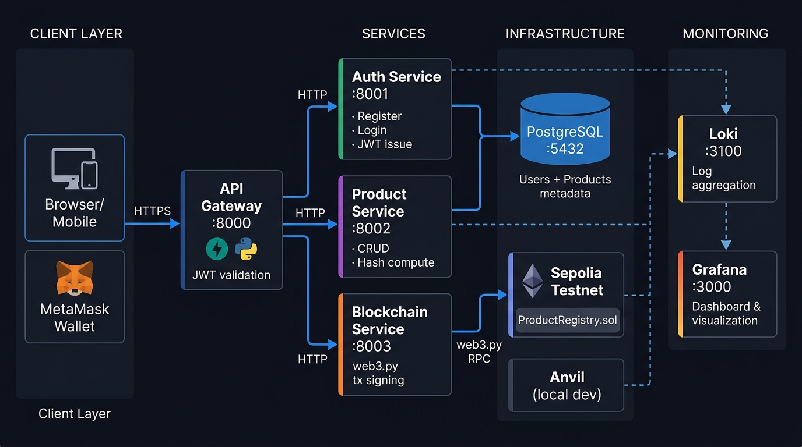
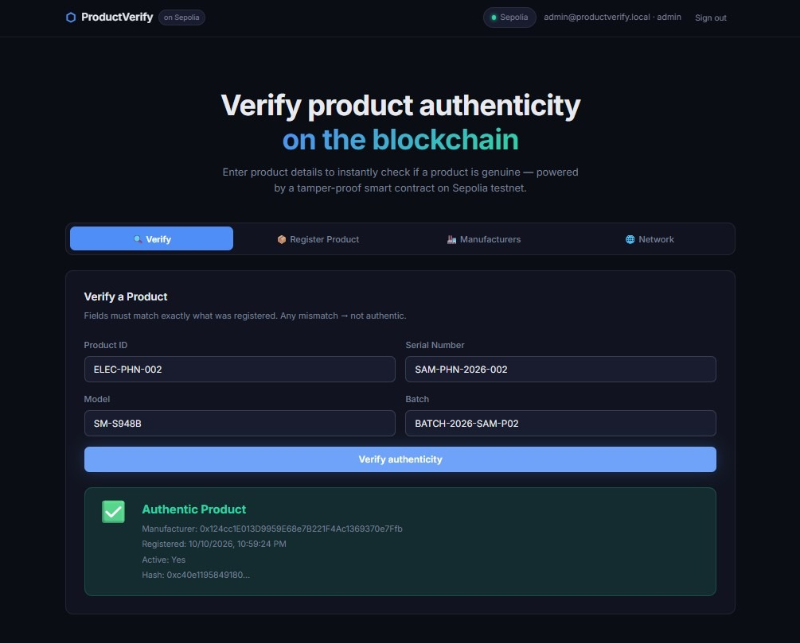
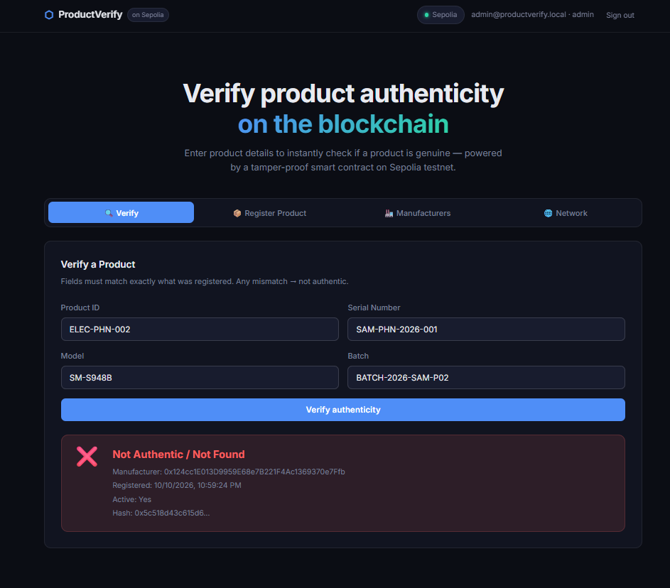
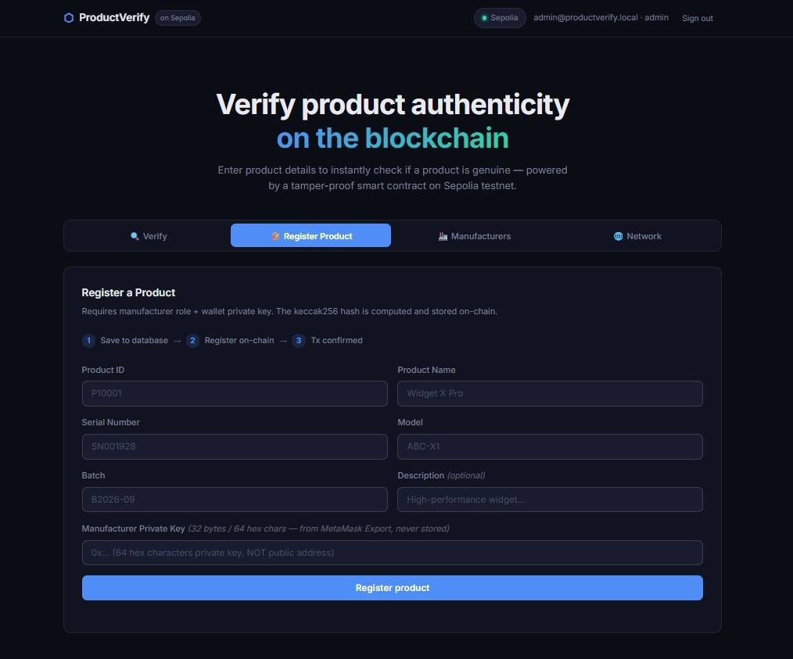
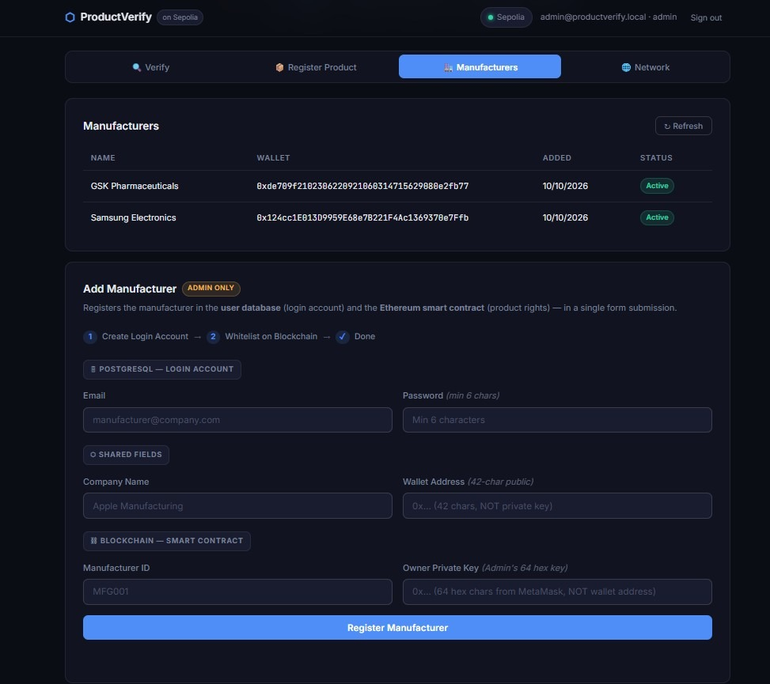
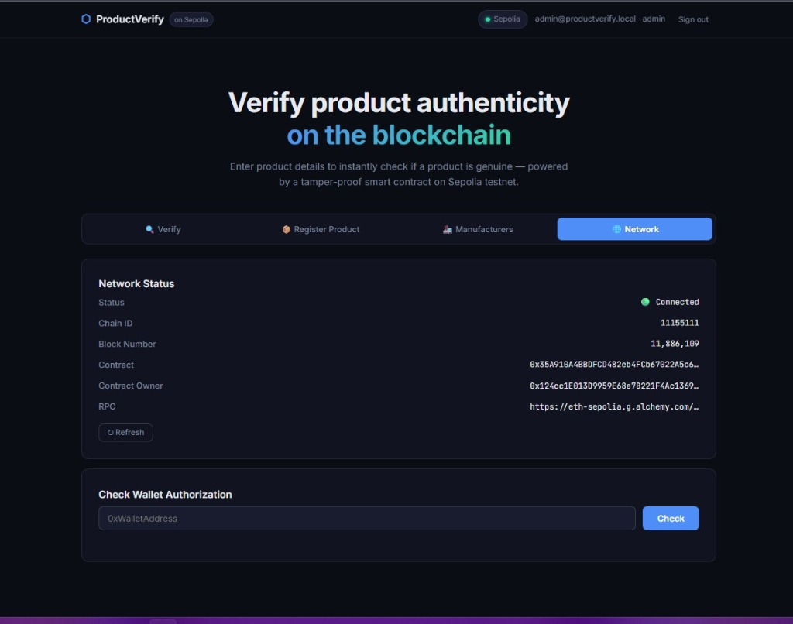
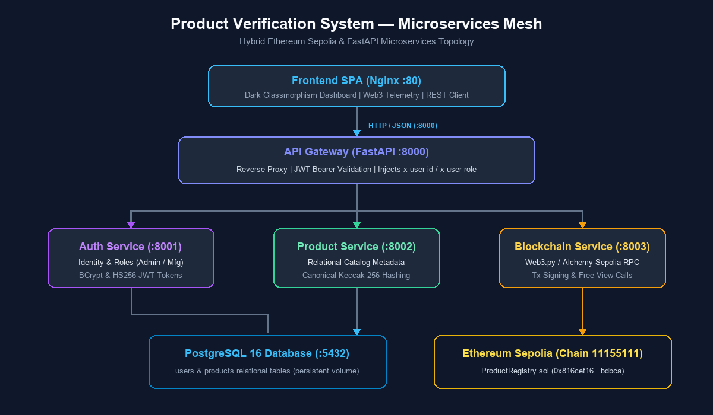

# Product Verification System

Manufacturers register a product fingerprint on an Ethereum contract. A later check tells you whether the product id, serial, model, and batch you typed match that record and whether the record is still active.

A match does **not** prove the physical item is genuine. It proves those four strings were registered by an authorized manufacturer and have not been deactivated. A copied label presents the same strings and gets the same answer. See [Cloned labels](#cloned-labels).



## Local demo secrets

These defaults are intentional for a laptop demo. They are not safe anywhere else. The values are in this repository, so treat them as public.

| Default | Where | Why it is unsafe |
|---|---|---|
| JWT secret `change-me-in-production` | `docker-compose.yml` | Anyone can forge a token. |
| PostgreSQL `postgres` / `postgres` | `docker-compose.yml` | The database has no real password. |
| Admin login `admin@productverify.local` / `admin123` (also `admin@productverify.com`) | `database/init-scripts/01-init.sql` | The seeded admin password is published. |
| `OWNER_PRIVATE_KEY` `0xac0974bec39a17e36ba4a6b4d238ff944bacb478cbed5efcae784d7bf4f2ff80` | `docker-compose.yml` | This is Anvil account 0. Everyone knows it. Use it only with a local Anvil node. |

Replace all four before pointing the stack at a shared network. Auth and blockchain services log a warning when they see the demo JWT secret or the Anvil key.

## What a check actually returns

| Result | Meaning |
|---|---|
| Record matches | The four fields hash to the stored fingerprint and the product is active. |
| No match | The id was never registered, the fields differ, or the product was deactivated. |
| Catalog row only | The database has the product, but `is_on_chain` is still false until a mined receipt is checked. |

The contract stores a 32-byte hash, the registering wallet, a timestamp, and an active flag. Names and descriptions stay in PostgreSQL.

## How registration works

1. A manufacturer signs in. The API gateway checks the JWT, strips any client-sent `x-user-*` headers, and sets `x-user-id`, `x-user-role`, and `x-user-wallet` from the token.
2. The browser saves the catalog row with `POST /api/products/`. `created_by` comes from `x-user-id`, not from the query string. A manufacturer can later edit only rows they created. An admin can edit any row.
3. The browser asks `POST /api/blockchain/products/prepare` for unsigned `registerProduct` calldata. The private key is not sent to the API.
4. MetaMask signs and broadcasts that transaction. MetaMask chooses the nonce.
5. The browser calls `POST /api/products/{id}/mark-on-chain` with the transaction hash. The product service accepts the update only after the receipt contains `ProductRegistered` for that id and the on-chain hash matches the catalog. Until that returns, `is_on_chain` stays false.

Recall is the same shape. `PATCH` cannot flip `is_active` on a product that is already on-chain. The manufacturer signs `deactivateProduct` in MetaMask, then `POST /api/products/{id}/confirm-deactivation` checks the `ProductDeactivated` receipt before the database changes.

Public signup can create a customer only. An admin creates a manufacturer login with `POST /api/auth/manufacturers`, then signs `addManufacturer` in MetaMask with the contract owner account.

There is still a custodial admin path, `POST /api/blockchain/manufacturers`, which signs with `OWNER_PRIVATE_KEY` from the environment. The UI does not use it. That path takes the nonce with `pending` and runs the receipt wait in a worker thread so it does not freeze the event loop. Do not use the Anvil key for it on a public network.

## Cloned labels

Two different problems get called a clone.

**Hash collision.** The fingerprint is `keccak256(abi.encode(productId, serialNumber, model, batch))`. `abi.encode` length-prefixes each string, so `("ab","c")` and `("a","bc")` hash differently. `abi.encodePacked` does not, and those two tuples collide. `ProductRegistry.hashProduct` is the on-chain definition. The pipe string `productId|serial|model|batch` is only a label for humans. It is not the hash preimage.

**Copied label.** Encoding cannot see two physical stickers that carry the same four strings. A match still means "this record exists." Stopping that requires something the chain does not have:

- One serial per unit, printed once.
- A tamper-evident seal or scratch-off so the serial is not photographed in the store.
- A one-time code whose hash is stored off-chain and marked used on first presentation. A second presentation of the same code is a suspected copy. Putting that code in the contract calldata would publish it.
- Treat repeated verifications of one serial from different places as a lead, not as proof.

## Hash and roles

```text
keccak256(abi.encode(productId, serialNumber, model, batch))
```

Product and manufacturer ids are the UTF-8 string, right-padded to 32 bytes. They are not a keccak of the string. Maximum length is 32 bytes.

| Caller | Contract | API |
|---|---|---|
| Owner | `addManufacturer`, `removeManufacturer`, `deactivateProduct` | Admin JWT. UI asks the owner wallet to sign in MetaMask. |
| Active manufacturer | `registerProduct`, `deactivateProduct` for their own product | Manufacturer JWT. Catalog writes are limited to `created_by`. |
| Anyone | `verifyProduct`, `getProduct` (view, no gas) | No token. |

Only the gateway port (`8000`) should be reachable off the machine. The service ports trust `x-user-*` headers. The gateway is what strips and replaces them.

## Layout

```text
product-verification/
├── contracts/
│   ├── src/ProductRegistry.sol
│   ├── test/ProductRegistry.t.sol
│   └── script/Deploy.s.sol
├── foundry.toml
├── frontend/                    index.html, style.css, app.js
├── services/
│   ├── api-gateway/             :8000
│   ├── auth-service/            :8001
│   ├── product-service/         :8002
│   ├── blockchain-service/      :8003
│   └── common/                  hashing, logging, SQLAlchemy base
├── database/init-scripts/01-init.sql
├── tests/                       pytest for hashing and login
├── examples/                    sample JSON catalogs
├── docs/
│   ├── architecture/            contract, system, service, and UI notes
│   ├── images/                  diagrams and UI screenshots
│   ├── ERROR_TROUBLESHOOTING.md
│   └── PROJECT_PRESENTATION_SLIDES.md
├── postman_collection.json      older private-key requests; see below
├── docker-compose.yml
├── .env.example
├── OKF.md
└── AGENTS.md
```

Loki and Grafana are commented out in `docker-compose.yml`. This repo does not contain a `monitoring/` directory. Services log JSON to stdout and to `/app/logs`. Set `LOKI_URL` only if you run Loki yourself.

`postman_collection.json` is in the repo. Its registration requests still post a manufacturer private key to `/api/blockchain/products/register`. That route has been removed. Use the MetaMask flow above.

There is no Word or PowerPoint file in this repo. `docs/PROJECT_PRESENTATION_SLIDES.md` is the slide outline.

## Docs

| Doc | What it is |
|---|---|
| [OKF.md](OKF.md) | Longer operational notes. Prefer the code when they disagree. |
| [docs/architecture/01-smart-contract.md](docs/architecture/01-smart-contract.md) | Contract layout |
| [docs/architecture/02-system-architecture.md](docs/architecture/02-system-architecture.md) | Service diagram |
| [docs/architecture/03-service-guide-and-testing.md](docs/architecture/03-service-guide-and-testing.md) | Running services and curl examples |
| [docs/architecture/04-blockchain-setup-and-configuration.md](docs/architecture/04-blockchain-setup-and-configuration.md) | RPC, MetaMask, `.env` |
| [docs/architecture/UI_USER_GUIDE.md](docs/architecture/UI_USER_GUIDE.md) | Clicking through the UI |
| [docs/architecture/PRODUCT_REGISTRATION_EXAMPLES.md](docs/architecture/PRODUCT_REGISTRATION_EXAMPLES.md) | Sample products |
| [docs/ERROR_TROUBLESHOOTING.md](docs/ERROR_TROUBLESHOOTING.md) | Errors seen while building this |
| [postman_collection.json](postman_collection.json) | Older collection. Do not follow its private-key registration step. |

Screenshots, with forward-slash paths:








The registration screenshot may still show a private-key field. The current form asks MetaMask to sign instead.

## Run the stack

```bash
cp .env.example .env
```

Set `ETH_RPC_URL` and `CONTRACT_ADDRESS`. For a local chain, point both the RPC and MetaMask at Anvil (chain id `31337`) and leave the Anvil key only in that private environment.

```bash
docker compose up --build -d
```

- UI: http://localhost
- Gateway docs: http://localhost:8000/docs

Sign in as `admin@productverify.local` / `admin123` on a local demo, then change that password if anyone else can reach the machine.

Connect MetaMask to the same chain id the blockchain service uses. The owner account whitelists manufacturers. A manufacturer account, using its own MetaMask account, registers products.

## Contract tests and deploy

Install Foundry, then install the test library (it is not committed):

```bash
forge install foundry-rs/forge-std
forge test
```

Deploy and, separately, verify the source on Sepolia. This repository does not record an Etherscan verification. After you deploy:

```bash
forge script contracts/script/Deploy.s.sol --rpc-url $ETH_RPC_URL --broadcast
forge verify-contract <deployed-address> ProductRegistry --chain sepolia --etherscan-api-key $ETHERSCAN_API_KEY --watch
```

`OWNER_PRIVATE_KEY` in the environment is the deployer key for that script. Put the deployed address in `CONTRACT_ADDRESS`.

## Python tests

From the repo root, with the auth-service dependencies plus `tests/requirements.txt`:

```bash
pip install -r tests/requirements.txt
pytest tests
```

`tests/test_hashing.py` checks `abi.encode`, the packed-encoding collision, and id padding. `tests/test_login.py` checks login, a disabled account, and that public signup cannot grant admin or manufacturer.

## Ports

| Service | Port |
|---|---|
| frontend | 80 |
| api-gateway | 8000 |
| auth-service | 8001 |
| product-service | 8002 |
| blockchain-service | 8003 |
| postgres | 5432 |
