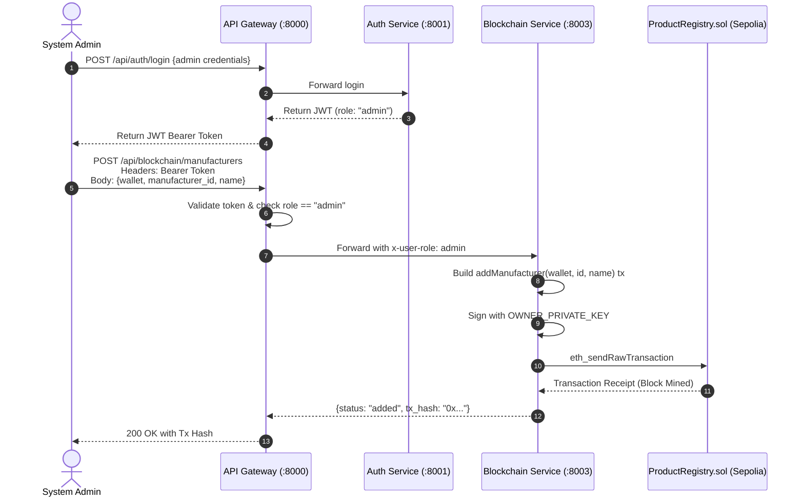
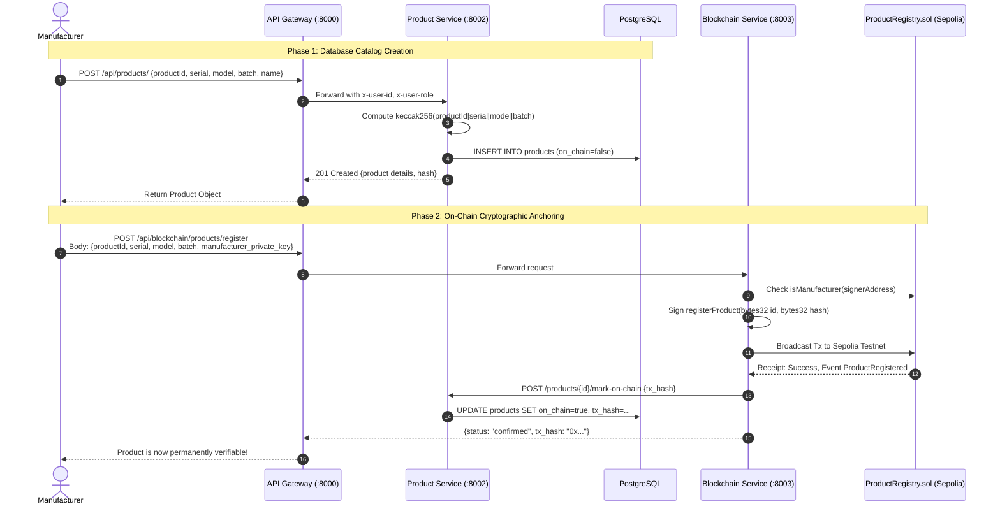
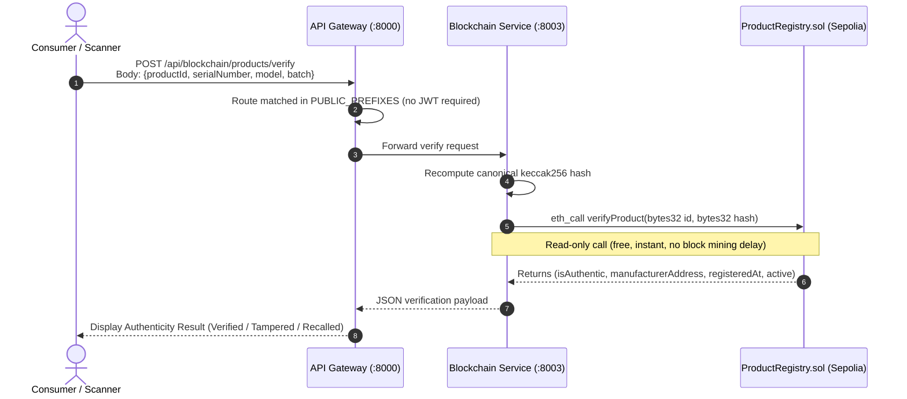

# Step 2 — System Architecture & Design

This document provides a comprehensive end-to-end explanation of the entire **Product Verification Platform**, explaining its design philosophy, architectural patterns, component responsibilities, data flow lifecycles, and security model.

---

## 1. System Overview & Core Philosophy

Counterfeit physical goods cost global industries hundreds of billions of dollars annually. Traditional serial number checks fail because centralized databases can be breached, internal records can be manipulated, and serial numbers can simply be copied onto counterfeit packaging.

This platform implements a **Hybrid On-Chain / Off-Chain Architecture**:
- **Off-Chain (PostgreSQL + FastAPI Microservices)**: Stores heavy, mutable, queryable business metadata (manufacturer profiles, product descriptions, serial numbers, batch identifiers, timestamps, SKU catalogs).
- **On-Chain (Ethereum / EVM Smart Contract)**: Stores immutable, tamper-evident cryptographic proofs (`keccak256` hashes), manufacturer authorization records, and lifecycle statuses (active/deactivated).

```
                      ┌──────────────────────────────────────┐
                      │            Browser / UI              │
                      │  (HTML5 / CSS / JS Single Page App)  │
                      └──────────────────┬───────────────────┘
                                         │ HTTP (Port 8000)
                                         ▼
                      ┌──────────────────────────────────────┐
                      │          API Gateway :8000           │
                      │   - JWT verification & decoding      │
                      │   - Context injection (x-user-id/role│
                      │   - Reverse proxy routing            │
                      └───────┬──────────┬──────────┬────────┘
                              │          │          │
                 ┌────────────┘          │          └────────────┐
                 ▼                       ▼                       ▼
      ┌────────────────────┐  ┌────────────────────┐  ┌────────────────────┐
      │  Auth Service      │  │  Product Service   │  │ Blockchain Service │
      │  Port 8001         │  │  Port 8002         │  │ Port 8003          │
      │  - User Accounts   │  │  - Product CRUD    │  │ - web3.py EVM RPC  │
      │  - Bcrypt hashing  │  │  - DB Metadata     │  │ - Tx signing & gas │
      │  - JWT issuance    │  │  - keccak256 hash  │  │ - Free view calls  │
      └─────────┬──────────┘  └─────────┬──────────┘  └─────────┬──────────┘
                │                       │                       │
                └───────────┬───────────┘                       ▼
                            ▼                         ┌────────────────────┐
                ┌───────────────────────┐             │  Sepolia Testnet   │
                │     PostgreSQL 16     │             │  ProductRegistry   │
                │  - users table        │             │  Smart Contract    │
                │  - products table     │             └────────────────────┘
                └───────────────────────┘
                            │
               All Services push structured JSON logs
                            │
                            ▼
                ┌───────────────────────┐
                │   Grafana Loki :3100  │  ──▶  Grafana Dashboards :3000
                │  (Local log fallback) │
                └───────────────────────┘
```

---

## 2. Component Breakdown & Responsibilities

### 2.1. Frontend (`frontend/`)
- **Technology**: Vanilla HTML5, modern CSS3 (Inter font, dark glassmorphism styling), pure ES6 JavaScript.
- **Delivery**: Served via lightweight Nginx on port `80` (or opened directly as a static file in any browser).
- **Features**:
  - Instant public product verification interface (accessible by any consumer without an account).
  - Manufacturer product registration dashboard with automatic hash previews.
  - Admin manufacturer authorization panel (granting and revoking on-chain manufacturer privileges).
  - Real-time blockchain network status telemetry (Chain ID, latest block number, contract address, wallet connectivity).
  - Client-side JWT session management in `localStorage`.

### 2.2. API Gateway (`services/api-gateway/` — Port 8000)
- **Role**: Single entry point protecting backend services from direct public exposure.
- **Routing Rules**:
  - `/api/auth/**` $\rightarrow$ `auth-service:8001/auth/**`
  - `/api/products/**` $\rightarrow$ `product-service:8002/products/**`
  - `/api/blockchain/**` $\rightarrow$ `blockchain-service:8003/blockchain/**`
- **Security & Gateway Offloading**:
  - Validates bearer JWT tokens using shared `JWT_SECRET_KEY`.
  - Maintains a whitelist of public routes (`/api/auth/register`, `/api/auth/login`, `/api/blockchain/products/verify`, `GET /api/products/**`).
  - Extracts JWT claims and injects trusted internal headers: `x-user-id` and `x-user-role`.
  - Strips incoming client-supplied `x-user-*` headers to eliminate header spoofing.
  - Manages Cross-Origin Resource Sharing (CORS) for web clients.

### 2.3. Auth Service (`services/auth-service/` — Port 8001)
- **Role**: Identity provider and role-based access controller (RBAC).
- **Entities**:
  - `User`: `id` (UUID), `email`, `hashed_password` (Bcrypt), `full_name`, `role` (`admin`, `manufacturer`, `customer`), `wallet_address`, `is_active`, `created_at`.
- **Token Format**: Stateless HS256 JWT containing `sub` (User ID), `role`, and expiration timestamp (`exp`).

### 2.4. Product Service (`services/product-service/` — Port 8002)
- **Role**: Relational catalog store and hash authority.
- **Entities**:
  - `Product`: `id` (UUID), `product_id` (human ID, e.g., `P10001`), `name`, `serial_number`, `model`, `batch`, `product_hash` (keccak256 hex), `on_chain` (bool), `tx_hash`, `created_by` (UUID), `created_at`.
- **Cryptographic Synchronization**:
  - Uses `common.crypto.hashing.keccak256_product` to generate the deterministic canonical hash string:
    $$\text{Hash} = \text{keccak256}(\text{productId} \parallel "|" \parallel \text{serial} \parallel "|" \parallel \text{model} \parallel "|" \parallel \text{batch})$$
  - Guarantees that the hash calculated off-chain matches the exact byte sequence evaluated on-chain by the smart contract.

### 2.5. Blockchain Service (`services/blockchain-service/` — Port 8003)
- **Role**: EVM communication engine via `web3.py`.
- **Capabilities**:
  - **Read Transactions (Zero Gas)**: Executes `verifyProduct()`, `getProduct()`, `isManufacturer()`, `getAllManufacturers()` without spending ETH or requiring wallet private keys.
  - **Write Transactions (On-Chain)**: Signs transactions using either the `OWNER_PRIVATE_KEY` (for manufacturer management) or the `manufacturer_private_key` (for product registration/deactivation).
  - Handles nonce management, gas price fetching, receipt polling (`wait_for_transaction_receipt`), and error extraction from reverted calls.

### 2.6. Smart Contract (`contracts/src/ProductRegistry.sol`)
- **Role**: Decentralized immutable truth engine.
- **Key Invariants**:
  - Only authorized manufacturer wallet addresses can register products.
  - A registered product ID cannot be overwritten or registered twice.
  - Deactivation can only be performed by the registering manufacturer or the contract owner.
  - Emits real-time EVM events: `ProductRegistered`, `ProductDeactivated`, `ManufacturerAdded`, `ManufacturerRemoved`.

### 2.7. Observability & Logging (`monitoring/` + `services/common/logging/`)
- **Tri-Modal Logging Strategy**:
  1. **Standard Output**: Formatted JSON lines stream to stdout (captured natively by Docker container logging drivers).
  2. **Local Rotating File Store**: Rotates 5 files of 10MB each under `/app/logs/<service-name>.log`. Stored in dedicated Docker named volumes so logs persist indefinitely even if the logging stack crashes.
  3. **Loki Remote Push**: Asynchronous HTTP push to Grafana Loki (`http://loki:3100`). Configured with a 1-second non-blocking timeout—if Loki is unreachable, the services log a warning and continue operating without latency degradation.
- **Grafana Visualization**:
  - Pre-provisioned datasources and dashboard JSON (`monitoring/grafana/dashboards/product-verification.json`).
  - Dedicated panels for error rates, service traffic, blockchain event tracking, and auth auditing.

---

## 3. End-to-End Execution Flows

### 3.1. Flow 1: Manufacturer Onboarding (Admin Flow)



---

### 3.2. Flow 2: Registering a Product (2-Phase Commit)

Registration uses a two-phase architecture to guarantee both rich metadata querying and decentralized immutability:



---

### 3.3. Flow 3: Customer Product Verification (Zero-Gas Public Verification)

Consumers scanning a QR code or checking an item online do **not** need an account, do **not** need MetaMask, and do **not** spend any gas fees:



---

## 4. Canonical Hashing Specification

To ensure cryptographic consistency between Python and Solidity, the system uses strict serialization:

$$\text{Canonical String} = \text{product\_id} + "|" + \text{serial\_number} + "|" + \text{model} + "|" + \text{batch}$$

In Python (`services/common/crypto/hashing.py`):
```python
def canonical_product_string(product_id: str, serial_number: str, model: str, batch: str) -> str:
    return f"{product_id.strip()}|{serial_number.strip()}|{model.strip()}|{batch.strip()}"

def keccak256_product(product_id: str, serial_number: str, model: str, batch: str) -> bytes:
    canonical = canonical_product_string(product_id, serial_number, model, batch)
    return Web3.keccak(text=canonical)
```

In Solidity (`contracts/src/ProductRegistry.sol`):
```solidity
// The contract verifies against the raw bytes32 hash passed to verifyProduct
function verifyProduct(
    bytes32 productId,
    bytes32 productHash
) external view returns (
    bool isAuthentic,
    address manufacturer,
    uint256 registeredAt,
    bool active
) {
    Product memory p = _products[productId];
    if (p.registeredAt == 0 || !p.active) {
        return (false, p.manufacturer, p.registeredAt, p.active);
    }
    return (p.productHash == productHash, p.manufacturer, p.registeredAt, p.active);
}
```

If a counterfeiter attempts to swap a serial number or duplicate packaging with a mismatched batch:
1. The client sends the details found on the physical box.
2. The backend hashes those specific fields.
3. The resulting hash fails equality check against `p.productHash` stored on-chain.
4. `is_authentic: false` is returned immediately.

---

## 5. Security & Isolation Matrix

| Layer | Threat Vector | Mitigation Strategy |
|---|---|---|
| **Client / Public** | Header spoofing (`x-user-role: admin`) | Gateway unconditionally drops any client-sent `x-user-*` headers before proxying. |
| **Authentication** | Token theft / replay | Short-lived JWTs (24h default), HS256 algorithm, strongly random secret key. |
| **Database** | Direct data tampering by DB admin | DB admin can change metadata in Postgres, but cannot alter the on-chain hash. Verification will immediately fail, flagging tampering. |
| **Blockchain** | Unauthorized product registration | `registerProduct()` checks `isManufacturer[msg.sender] == true`. Reverts if unauthorized. |
| **Smart Contract** | Contract hijacking | `onlyOwner` modifier protects manufacturer addition and deactivation controls. |
| **Keys & Secrets** | Private key exposure | Keys are loaded strictly from environment variables (`.env`) injected at container runtime; never baked into Docker images or committed to git. |
| **Logging** | Observability outage blocking traffic | Logging client uses non-blocking 1s timeout and dual-writes to isolated local rotating files. |
